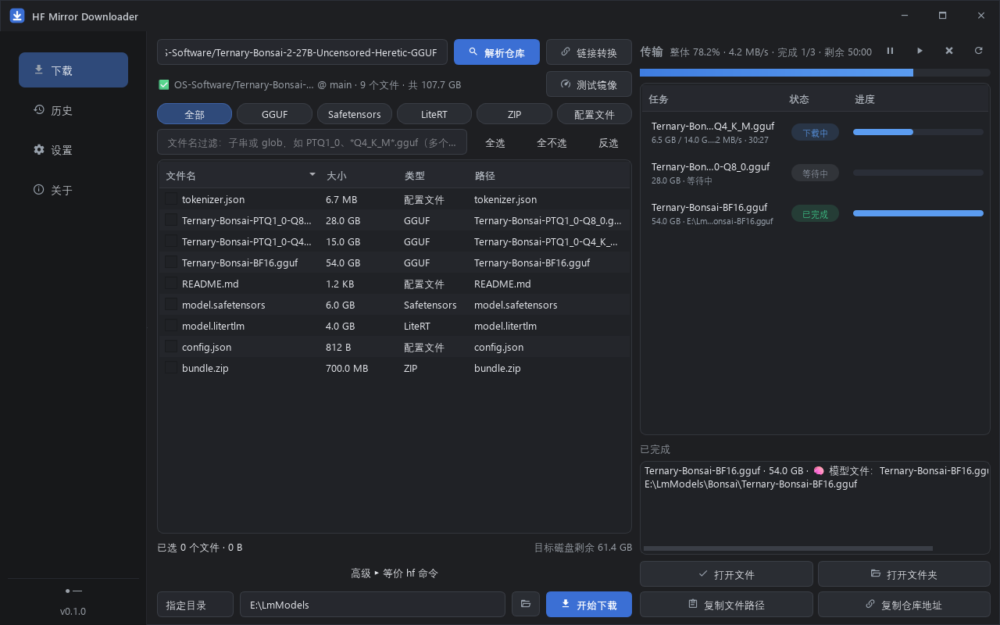

# HF Mirror Downloader

给 Hugging Face 模型下载提供一个简单、现代的 Windows 桌面 GUI：粘贴仓库或文件链接 → 勾选文件 → 下载。
默认通过 **hf-mirror** 镜像下载，无需记忆任何 `hf` / `huggingface-cli` 命令。



## 功能特性

- **模糊搜索（无需知道作者）**：输入框直接敲关键词（如 qwen3 4b、ternary bonsai）即按下载量搜索全站模型，结果含下载量/赞/任务类型，可二次过滤，双击即进入文件列表。
- **链接解析**：支持官方/镜像仓库链接、`blob`/`resolve` 文件链接（自动定位子目录文件）、`组织/仓库` 短格式、`仓库@分支` 语法、`refs/pr/N` 等。
- **文件列表**：勾选下载，显示大小 / 类型 / 路径，支持点击列排序。
- **快速筛选**：全部 / GGUF / Safetensors / LiteRT / ZIP / 配置文件 一键筛选；文件名过滤框同时支持**子串**（如 `PTQ1_0`）和 **glob 通配**（如 `*Q4_K_M*.gguf`，多个条件用空格或逗号分隔）。
- **两种下载模式**：
  - **指定目录**：文件直接放在你选择的目录（如 `E:\LmModels\Bonsai`），即下即用；
  - **HF 缓存**：完整兼容 huggingface_hub 官方缓存结构（`blobs` / `refs` / `snapshots`），下载完成后直接显示 snapshot 中的**真实文件路径**（如 `E:\huggingface_cache\models--Qwen--Qwen3-4B\snapshots\<commit>\model.gguf`），而不是 blob 的 SHA 文件名。
- **大文件与断点续传**：底层复用 `huggingface_hub` 官方下载（endpoint 直指镜像），支持 Range 续传；暂停 / 恢复 / 取消后再次下载自动从断点继续，甚至重启程序也能续传。
- **下载管理**：整体进度 + 单文件进度、当前速度、平均速度、已下载 / 总大小、ETA、失败自动重试（指数退避）、最大并发数 1/2/4/8 可调。续传恢复后进度从已下载处继续，不从头走。
- **队列跨会话持久化**：未完成的下载队列自动保存；意外退出 / 暂停后重启，下载页顶部会出现「全部续传」横幅，一键从断点恢复，无需重新勾选。
- **关闭保护 + 托盘**：有任务在下载时关闭窗口，可选择「最小化到托盘（下载继续）」或「退出并暂停」，可记住选择；托盘菜单可随时恢复窗口；全部结束时气泡提醒。
- **镜像 failover**：网络类失败达到一定数量时提示「测试并切换镜像」——对话框并行测试 hf-mirror.net / hf-mirror.com / 官方源的延迟，一键切换并自动重试失败任务。
- **401 内联处理**：gated 模型失败后直接在下载页横幅里填 Token、一键重试，不用跳去设置页。
- **“已下载”标记**：文件列表中标注历史已成功下载、或目标目录中已存在的文件，避免重复勾选。
- **磁盘空间检查**：下载前显示「总下载量 vs 目标磁盘剩余空间」，不足时警告；默认目录所在磁盘不存在时启动即提示。
- **镜像测试**：一键检测 DNS / 延迟 / HTTP 状态。
- **链接转换工具**：官方链接 ↔ 镜像直链，`blob` 自动转 `resolve`，可复制、可浏览器打开。
- **等价命令预览**：自动生成与当前选择完全等价的 `hf download ...` 命令（普通用户无需理会）。
- **下载历史**：SQLite 本地存储，双击打开所在目录、一键重新下载。
- **HF Token（可选）**：gated / 私有模型遇到 401/403 时给出中文提示，Token 使用 **Windows DPAPI** 按当前用户加密保存，不写入日志与历史。
- **双栏工作台布局**：左侧选文件、右侧「传输」面板常驻（整体/单文件进度、状态胶囊、已完成操作一目了然），可拖动分割条调整比例。
- **无边框自定义标题栏**：支持拖动、双击最大化、边缘缩放与 Win11 贴边布局；侧栏底部实时显示当前下载源与健康状态灯。
- **深色 / 浅色主题**，高 DPI 适配，中文界面。

## 环境要求

- Windows 10/11（64 位）
- Python 3.11+（仅从源码运行或自行构建时需要；打包后的 exe 不需要 Python）

## 从源码运行

```powershell
python -m venv .venv
.venv\Scripts\pip install -r requirements.txt
.venv\Scripts\python main.py
```

## 构建 exe

```powershell
.\build.ps1              # 一键：创建 venv → 装依赖 → 跑测试 → 打包
.\build.ps1 -SkipTests   # 跳过测试
.\build.ps1 -OneDir      # 目录模式（启动更快，输出 dist\HF-Mirror-Downloader\）
```

产物：`dist\HF-Mirror-Downloader.exe`（单文件，绿色免安装，目标机器无需 Python）。构建脚本同时输出 `dist\SHA256SUMS.txt`，发布时请随 exe 一起提供。

## 安装与信任（SmartScreen / 杀毒软件误报）

- **SmartScreen**：首次运行若弹出“Windows 已保护你的电脑”，点「更多信息」→「仍要运行」。
- **杀毒软件误报**：PyInstaller 打包的单文件 exe 偶发被 360 / Defender 等误报，属常见现象。可先核对 SHA256（见 `SHA256SUMS.txt`，`certutil -hashfile HF-Mirror-Downloader.exe SHA256` 自行校验），确认一致后加入白名单；也可改用 `.\build.ps1 -OneDir` 的目录版（误报率更低）。
- 本程序不联网上传任何数据；Token 仅在本机 DPAPI 加密存储。

## 使用说明

1. 顶部粘贴链接，例如：
   - `https://huggingface.co/Qwen/Qwen3.5-4B`
   - `Qwen/Qwen3.5-4B`
   - `https://huggingface.co/xxx/xxx/blob/main/model.gguf`
2. 点击 **解析仓库**，在文件列表中筛选并勾选需要的文件。
3. 选择下载模式与目标目录，点击 **开始下载**。
4. 完成后在底部「本次会话已完成」区可打开文件 / 文件夹、复制路径 / 仓库地址。

### 缓存模式说明

缓存目录默认 `E:\huggingface_cache`，等价于 `HF_HUB_CACHE`（即 `models--*` 的父目录）。
若该目录下已有 `hub/models--*` 结构（`HF_HOME` 风格），程序会自动使用 `hub` 子目录。
下载完成后程序展示的路径就是 `snapshots\<commit>\<文件名>`，可直接复制给训练/推理工具使用。

> Windows 未开启开发者模式时，系统可能不允许创建符号链接，huggingface_hub 会自动退化为复制文件，功能不受影响，只是同仓库多 revision 时占用更多磁盘。

### 断点续传说明

- 暂停/取消产生的 `.incomplete` 临时文件会保留；重新下载时自动从断点继续。
- 「设置 → 清理未完成的临时文件」可一键清理这些残留（会丢弃对应断点）。
- 单文件内部为单连接续传；多文件并发数可在设置中调整（默认 4）。

## 常见问题

| 现象 | 说明 |
| --- | --- |
| 提示需要登录 / 接受许可 | 模型是 gated 或私有：直接在下载页顶部横幅填写 HF Token 并一键重试（也可到「设置」填写），并先在模型网页上同意许可协议 |
| 镜像测试失败 / 下载频繁失败 | 检查网络/代理；或点击横幅里的「测试并切换镜像」，程序会并行测试各源延迟供一键切换 |
| 重启后出现「全部续传」横幅 | 这是上次未完成的下载队列：点「全部续传」自动从断点继续；不需要就点「清除记录」 |
| 个别文件自动“改用降级下载” | 某些镜像缓存节点会丢失 HF 标准响应头，程序检测到后自动改用内置 HTTP 续传下载（内容 sha256 校验），无需干预 |
| 大小列显示 `—` | 程序已自动尝试 tree → model_info 两个端点获取大小；若镜像两个端点都拿不到才退回仅文件名，稍后重新解析通常可恢复 |
| 超过 50 GB 的单文件 | 受 huggingface_hub 限制，普通 HTTP 通道最大 50 GB，更大文件需 xet 通道（镜像一般不支持） |
| 日志 | 「设置 → 打开日志」，文件位于 `logs\app.log`（源码运行时在项目根目录） |

## 项目结构

```
hf-mirror-downloader/
├── main.py                  # 程序入口
├── app/
│   ├── core/                # 纯 Python 核心（无 Qt 依赖，可独立测试）
│   │   ├── url_parser.py        # 链接解析
│   │   ├── hf_client.py         # HfApi 封装（列表 / 镜像测试）
│   │   ├── download_engine.py   # 下载引擎（并发/暂停/续传/重试/降级下载）
│   │   ├── errors.py            # 错误分类与中文翻译
│   │   ├── cache_utils.py       # 缓存目录解析 / 命令预览 / 临时文件清理
│   │   ├── history.py           # SQLite 历史
│   │   ├── secure_store.py      # Token DPAPI 加密存储
│   │   └── formatting.py
│   ├── models/              # 数据模型（RepoFile / DownloadTask / AppSettings）
│   ├── services/            # 路径定位 / 日志脱敏 / 设置持久化
│   └── ui/                  # PySide6 界面（下载/历史/设置/关于/链接转换/主题）
├── assets/                  # 图标
├── scripts/                 # 图标生成 / 真实镜像在线验证脚本
├── tests/                   # 单元测试 + Fake HF 服务器端到端测试
├── requirements.txt
├── build.ps1                # 一键构建
└── README.md
```

## 设计要点（给维护者）

- **不重复造轮子**：下载走 `hf_hub_download(endpoint=镜像)`，缓存结构、etag、Windows 符号链接降级、etag 超时等全部由官方库处理。
- **进度与暂停机制**：向 `hf_hub_download` 传入自定义 `tqdm` 子类；`update()` 钩子内检查取消标志，需要暂停/取消时抛出协作式异常——官方库关闭文件后 `.incomplete` 保留，下次调用自动 Range 续传。
- **GUI 不卡顿**：下载在 worker 线程；UI 以 400ms 定时器轮询引擎快照刷新，不使用跨线程信号。
- **文件列表三级降级**：`list_repo_tree(expand=True)`（一次拿全大小，失败自动重试一次）→ `model_info(files_metadata=True)`（不同端点，同样带大小，也用于补全 tree 缺失的大小）→ `list_repo_files`（仅文件名）。401/403/404 不降级、直接给出中文提示。这保证了大小列尽量不出现 `—`。
- **大列表性能**：填充时抑制逐行 `itemChanged` 信号（否则每行触发全量统计，O(n²)）；过滤输入 180ms 防抖；批量隐藏时关闭重绘；小写路径与类型在填充时预计算。实测 5000 文件加载约 130ms、过滤约 20ms。
- **镜像兼容性**：hf-mirror 的部分 Cloudflare 缓存节点会丢失 `X-Repo-Commit` 等响应头，导致官方库拒绝下载；引擎检测到该情况自动降级为自研 HTTP 续传下载，并按官方缓存结构落盘（LFS 文件做 sha256 校验）。
- **日志脱敏**：日志过滤器会抹掉 `hf_*` 形态的 Token 及用户配置的 Token 原文。

## 测试

```powershell
.venv\Scripts\python -m pytest tests -q
```

包含：链接解析、筛选/分类、缓存目录解析、命令预览、历史存取等单元测试；以及基于本地 Fake HF 服务器的端到端测试——覆盖两种下载模式、暂停→恢复内容一致性、模拟进程重启后续传、取消、500/断流自动重试、401 门禁提示与 Token 重试、并发上限。另有 `scripts/live_check.py` 用于对真实镜像做在线冒烟验证。

## 路线图

- [x] Phase 1：GUI / 链接解析 / 文件列表 / 镜像下载 / 进度 / 断点续传 / 两种目录模式
- [x] Phase 2：历史 / Token / 镜像测速 / glob 筛选 / 命令预览 / 链接转换
- [x] Phase 3：PyInstaller 打包 / 深浅主题
- [x] Phase 4：队列跨会话持久化 / 托盘与关闭保护 / 镜像 failover / 401 内联 Token / 已下载标记
- [ ] 更多：量化快选 chips、限速、数据集仓库支持、自动更新

## 许可

仅供学习交流使用，模型文件版权归原发布者所有。
